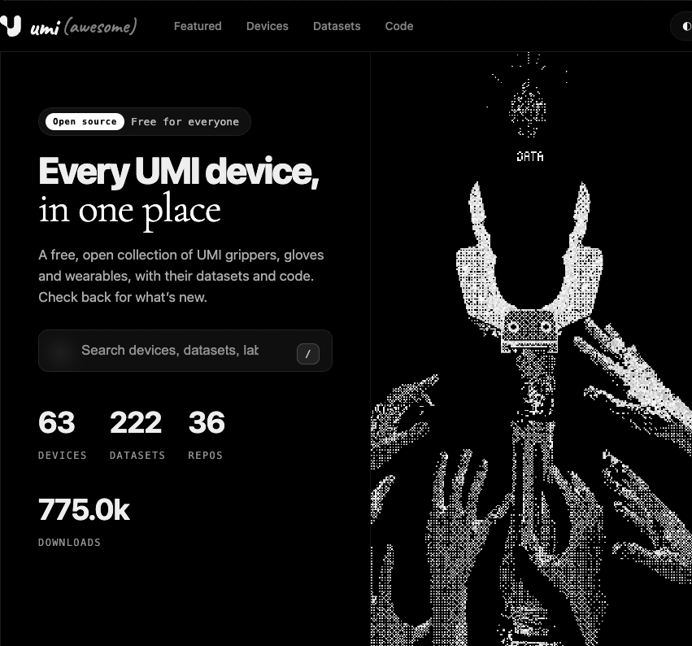
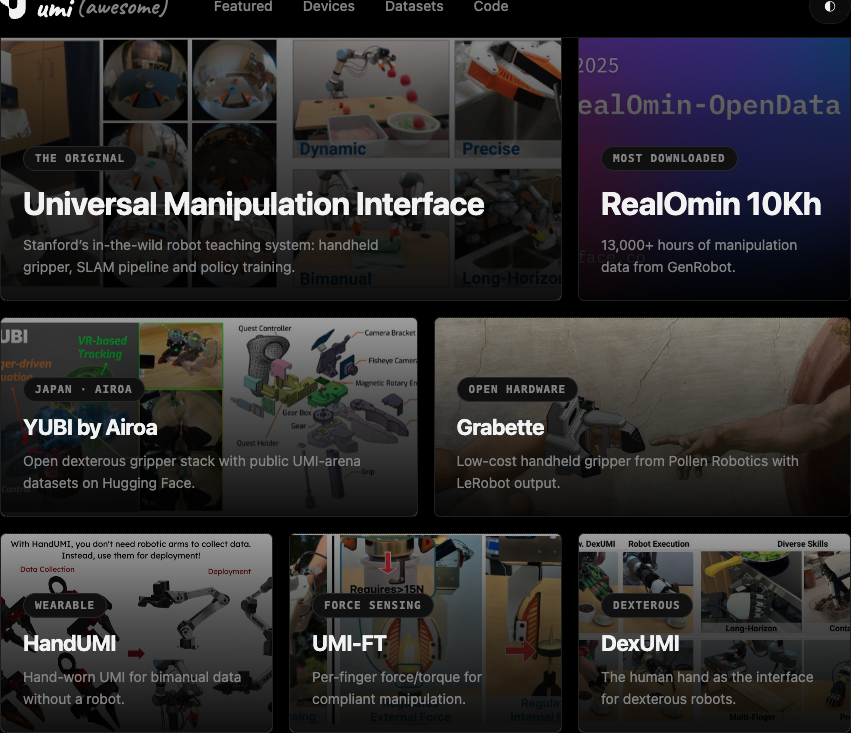

  

<h1 align="center">Awesome UMI: an illustrated field guide</h1>

  
  
  
  

  
  

  <strong>Discover the devices, datasets, papers, and code bringing in-the-wild robot teaching to life.</strong>

This community-curated collection covers the **Universal Manipulation Interface (UMI)** and related systems, from handheld grippers and wearable devices to tactile sensing and large-scale datasets.

Start with Stanford's original [paper and code](https://github.com/real-stanford/universal_manipulation_interface).

## Contents

- [Core](#core)
- [Extensions from the original team](#extensions-from-the-original-team)
- [HandUMI](#handumi)
- [Grabette](#grabette)
- [Hardware and grippers](#hardware-and-grippers)
- [Data collection variants](#data-collection-variants)
- [LeRobot and data pipelines](#lerobot-and-data-pipelines)
- [Tactile and multimodal](#tactile-and-multimodal)
- [Domain-specific applications](#domain-specific-applications)
- [Tools and visualization](#tools-and-visualization)
- [Datasets](#datasets)
- [Device catalog](#device-catalog)

## Core

- [real-stanford/universal_manipulation_interface](https://github.com/real-stanford/universal_manipulation_interface) ⭐ 1.6k: The original UMI: hardware, data pipeline and policy training.

## Extensions from the original team

DexUMI, UMI-FT and iPhUMI are in the [Device catalog](#device-catalog).

- [real-stanford/umi-on-legs](https://github.com/real-stanford/umi-on-legs) ⭐ 565: UMI on Legs. Mobile manipulation policies using whole-body controllers.

## HandUMI

Hand-worn UMI variant for collecting bimanual manipulation data without a robot in the loop.

- [murobotics-ai/handumi-hw](https://github.com/murobotics-ai/handumi-hw) ⭐ 118: Hardware. Modular for any parallel-jaw gripper.
- [murobotics-ai/handumi-sw](https://github.com/murobotics-ai/handumi-sw) ⭐ 81: Software. Synchronized bimanual collection, calibration, QA, replay and retargeting to any bimanual robot.
- [murobotics-ai/handumi-quest-app](https://github.com/murobotics-ai/handumi-quest-app) ⭐ 3: Meta Quest app (Unity) that streams headset and controller telemetry for HandUMI.
- [raulbastidas1203/handumi-IK](https://github.com/raulbastidas1203/handumi-IK): Inverse kinematics for HandUMI.

## Grabette

[Grabette](https://huggingface.co/blog/grabette) is an open, low-cost handheld gripper from Pollen Robotics, directly inspired by UMI. It records demonstrations with a human hand and no robot, then converts them to LeRobot-format datasets on the Hugging Face Hub. It also has a motorized robot-side twin, Gripette, to run the learned policies.

- [pollen-robotics/elec_grabette](https://github.com/pollen-robotics/elec_grabette): Electronics and BOM.
- [pollen-robotics/grabette-slam](https://huggingface.co/spaces/pollen-robotics/grabette-slam): Hugging Face Space that SLAM-checks recordings (RTAB-Map) and converts them to LeRobot format.
- [chouziel/dataset-cup-0107](https://huggingface.co/datasets/chouziel/dataset-cup-0107): Example dataset of 200 "grasp a cup" demos.
- [SteveNguyen/pick_cup_0107_smooth-best](https://huggingface.co/SteveNguyen/pick_cup_0107_smooth-best): Diffusion Policy trained on that dataset, evaluated on an OpenArm.

## Hardware and grippers

- [specialist-ai/specialist](https://github.com/specialist-ai/specialist) ⭐ 42: Specialist handheld and actuated UMI-style grippers, with their software.
- [specialist-ai/specialist_description](https://github.com/specialist-ai/specialist_description) ⭐ 2: URDF, MJCF and xacro descriptions of the Specialist grippers.
- [actuated-umi/actuated-umi-gripper](https://github.com/actuated-umi/actuated-umi-gripper) ⭐ 46: Actuated version of the UMI gripper.
- [XenseRobotics-AI/XTac-UMI-G1-Docs](https://github.com/XenseRobotics-AI/XTac-UMI-G1-Docs) ⭐ 5: Docs for XTac-UMI G1, a handheld tactile gripper.
- [sri299792458/robotiq-2f85-umi-gripper](https://github.com/sri299792458/robotiq-2f85-umi-gripper): 3D-printable UMI-style soft gripper for the Robotiq 2F-85.
- [jkw0701/umi-galaxy-s21](https://github.com/jkw0701/umi-galaxy-s21): UMI gripper built around a Samsung Galaxy S21.
- [woolimi/pinkrab](https://github.com/woolimi/pinkrab): Wall-mounted bimanual robot plus "Hermit", a handheld UMI gripper that teaches it.

## Data collection variants

- [linker-bot/umi-dex](https://github.com/linker-bot/umi-dex) ⭐ 27: Dexterous manipulation data acquisition.
- [Teddy2209/SUMI](https://github.com/Teddy2209/SUMI): Teleoperation device (Susgrip) inspired by UMI.
- [HenryWJL/universal_manipulation](https://github.com/HenryWJL/universal_manipulation) ⭐ 4: Upgraded version of UMI.

## LeRobot and data pipelines

Converters and capture pipelines that connect UMI data to [Hugging Face LeRobot](https://github.com/huggingface/lerobot) and other training stacks.

- [XenseRobotics-AI/xense-taccap-lerobot](https://github.com/XenseRobotics-AI/xense-taccap-lerobot) ⭐ 14: Tactile collection with the XTac-UMI G1 gripper, as a LeRobot v5.1 fork.
- [Auromix/OpenUMI](https://github.com/Auromix/OpenUMI) ⭐ 5: Wireless data collection with finger-mounted devices and a head camera streaming to an iPhone.
- [34328/umi2lerobot](https://github.com/34328/umi2lerobot) ⭐ 3: UMI to LeRobot conversion.
- [SteveNguyen/UMI_to_LeRobotDataset](https://github.com/SteveNguyen/UMI_to_LeRobotDataset): UMI Zarr to LeRobotDataset conversion script.
- [rebnoob/Umi_Lerobot_Retargeting](https://github.com/rebnoob/Umi_Lerobot_Retargeting): UMI to LeRobot retargeting.
- [Travelers111/PI0.5_pipeline](https://github.com/Travelers111/PI0.5_pipeline) ⭐ 3: LeRobot pi0.5 training pipeline compatible with UMI data.
- [ravikola02/egoumi](https://github.com/ravikola02/egoumi) ⭐ 1: UMI-style pinch gripper tracked by ArUco markers from an egocentric head camera, into a LeRobot dataset.
- [lakers38/umi-data-pipeline](https://github.com/lakers38/umi-data-pipeline): Insta360 recordings to metric trajectories (ORB-SLAM3 / OpenVINS) and calibration.
- [treading-the-void/umi-companion-capture](https://github.com/treading-the-void/umi-companion-capture): Bimanual capture with a global camera, AprilTag, Quest and SLAM.
- [MaFeifei5/umi-diffusion-policy](https://github.com/MaFeifei5/umi-diffusion-policy): Diffusion policy trained on UMI data and deployed on an AgileX arm.
- [umeow0716/hommi_diffusion_policy](https://github.com/umeow0716/hommi_diffusion_policy): Standalone diffusion policy implementations adapted from HoMMI and UMI.

## Tactile and multimodal

- [PolyUMI-VisTA/PolyUMI-system](https://github.com/PolyUMI-VisTA/PolyUMI-system) ⭐ 9: PolyUMI. Visual-auditory-tactile manipulation for imitation learning.
- [yuchen-ji/tacumi](https://github.com/yuchen-ji/tacumi) ⭐ 2: Vision and tactile manipulation based on UMI.

## Domain-specific applications

- [DisneyCA/umi-underwater](https://github.com/DisneyCA/umi-underwater): UMI-Underwater. Learns underwater manipulation without underwater teleoperation.
- [CarlYang-coder/UMI-Manipulation-in-Construction](https://github.com/CarlYang-coder/UMI-Manipulation-in-Construction): End-to-end pipeline for construction tasks, built on UMI-FT.
- [qinyh10300/umi](https://github.com/qinyh10300/umi) ⭐ 3: Reproduction of UMI on a Franka arm.

## Tools and visualization

- [umi-3d/umi-data-visualizer](https://github.com/umi-3d/umi-data-visualizer): 3D visualization of UMI data with Rerun.
- [rerun-io/rerun](https://github.com/rerun-io/rerun) ⭐ 11.7k: Visualize, query and stream multimodal robotics data.

## Datasets

- [Open X-Embodiment (OXE)](https://robotics-transformer-x.github.io/) - Real / multi-embodiment — Google DeepMind + 34 labs — 1M+ trajectories, 527 tasks.
- [DROID](https://droid-dataset.github.io/) - Real / manipulation — Stanford + 13 institutions — 76K trajectories, 350 hours.
- [RoboMIND](https://x-humanoid-robomind.github.io/) - Real / multi-embodiment — Beijing Humanoid Center + PKU — 107K trajectories, 479 tasks.
- [AgiBot World Colosseo](https://agibot-world.com/) - Real / manipulation — AgiBot — 1M+ trajectories, 2976 hours, 217 tasks.
- [FastUMI-100K](https://github.com/MrKeee/FastUMI-100K) - Real / manipulation — Shanghai AI Lab — 100K+ trajectories, 600 hours, 54 tasks.
- [DexWild Dataset](https://huggingface.co/datasets/boardd/dexwild-dataset) - Real / dexterous — CMU — 9505 episodes, 33 hours.
- [Gen-EgoData](https://huggingface.co/datasets/genrobot2025/Gen-EgoData) - Real / egocentric — GenRobot — 20,000+ hours, 500 tasks.
- [10Kh-RealOmin-OpenData](https://huggingface.co/datasets/genrobot2025/10Kh-RealOmin-OpenData) - Real / manipulation — GenRobot — 13,000+ hours.
- [Genie Sim Synthetic](https://github.com/AgibotTech/genie_sim) - Simulation — AgiBot — 10,000+ hours, 200 tasks.
- [DAIMON Public Tactile](https://modelscope.cn/datasets/daimonrobotics/Daimon-Infinity) - Real / tactile — DAIMON Robotics — 10,000+ hours, 2000 tasks.
- [HiFi-UMI-2K](https://huggingface.co/datasets/simple-world-lab/HiFi-UMI-2K) - Real / robot-free manipulation — Simple AI (Simple World Lab) — 482K+ episodes, 2000 hours.
- [CLAMP Dataset](https://doi.org/10.7910/DVN/HNS2Z4) - Real / haptic — Cornell University (EmPRISE Lab) — 12.3M samples, 5357 objects, 25.1k touches.
- [Nexdata-AI/50000-Hours-UMI-Embodied-Manipulation-Dataset](https://github.com/Nexdata-AI/50000-Hours-UMI-Embodied-Manipulation-Dataset): 50,000-hour UMI manipulation dataset.

## Device catalog

Each line gives the organization, first public year and license. Ordered oldest first.

### Handheld grippers

- [Dobb-E / RUM](https://dobb-e.com/) - Suction-cup reacher-grabber with a wrist-mounted iPhone that records RGB-D and 6-DoF pose for household demonstrations — NYU (Lerrel Pinto Lab) et al., 2023, MIT ([paper](https://arxiv.org/abs/2311.16098), [code](https://github.com/notmahi/dobb-e)).
- [Fast-UMI](https://fastumi.com/) ⭐ 180 - No SLAM calibration required; decoupled hardware design — Shanghai AI Lab et al., 2024, MIT ([paper](https://arxiv.org/abs/2409.19499), [code](https://github.com/zxzm-zak/FastUMI_Data)).
- [ForceMimic / ForceCapture](https://forcemimic.github.io/) - Force-Centric Imitation Learning with Force-Motion Capture System for Contact-Rich Manipulation — Shanghai Jiao Tong University, 2024, MIT ([paper](https://arxiv.org/abs/2410.07554), [code](https://github.com/ForceMimic)).
- [LEGATO](https://ut-hcrl.github.io/LEGATO) - Cross-embodiment morphology support; same tool mountable on robot side — UT Austin Human Centered Robotics Lab et al., 2024, MIT ([paper](https://arxiv.org/abs/2411.03682)).
- [ManiWAV](https://maniwav.github.io/) - UMI parallel-jaw gripper with embedded piezoelectric contact microphone ('ear-in-hand') for synchronous in-the-wild audio-visual demonstration collection — Stanford University et al., 2024, MIT ([paper](https://arxiv.org/abs/2406.19464)).
- [UMI](https://umi-gripper.github.io/) ⭐ 1.6k - Relative-trajectory action representation, inference-time latency matching — Stanford University et al., 2024, MIT ([paper](https://arxiv.org/abs/2402.10329), [code](https://github.com/real-stanford/universal_manipulation_interface)).
- [ActiveUMI](https://activeumi.github.io/) - Portable VR teleoperation kit with robot grippers on Meta Quest 3s controllers; records operator head motion for active egocentric perception during bimanual in-the-wild collection — Shanghai University et al., 2025 ([paper](https://arxiv.org/abs/2510.01607)).
- [CLAMP](https://emprise.cs.cornell.edu/clamp/) - Sensorized reacher-grabber under $200 that records active and passive thermal, normal force, contact vibration, and proprioception from in-the-wild grasps — Cornell University et al., 2025, open hardware ([paper](https://arxiv.org/abs/2505.21495), [code](https://github.com/empriselab/CLAMP)).
- [Cloud-UMI / UMIGen](https://arxiv.org/abs/2511.09302) - Records RGB and point cloud jointly; no Visual SLAM; visibility-aware optimization — Tsinghua University (Shenzhen International Graduate School), 2025, open hardware.
- [DAS Fingers](https://www.genrobot.ai/products/finger) - Bionic two-finger handheld collector; 220 mm max opening; millimeter-level trajectory; automatic voice annotation — GenRobot AI, 2025, proprietary.
- [DAS Gripper](https://www.genrobot.ai/products/das) - UMI-inspired handheld multimodal collector (vision, tactile, audio, IMU, magnetic encoder); MCAP output; cloud compression to ~2% of original size — GenRobot AI, 2025, proprietary.
- [DM-DataClaw](https://www.dmrobot.com/en/products/) - Handheld parallel-jaw data collection gripper with vision-based tactile sensors (110,000 sensing units, 120Hz); used alongside DM-DataDex to build the Daimon-Infinity omni-modal dataset — Daimon Robotics, 2025, proprietary.
- [exUMI](https://silicx.github.io/exUMI) - Extensible Robot Teaching System with Action-aware Task-agnostic Tactile Representation — Shanghai Jiao Tong University, 2025, MIT ([paper](https://arxiv.org/abs/2509.14688)).
- [MV-UMI](https://mv-umi.github.io) - Third-person view reduces OOD gap; ~47% gain on scene-understanding tasks — NYU Abu Dhabi, 2025, open hardware ([paper](https://arxiv.org/abs/2509.18757)).
- [Pika Sense](https://global.agilex.ai/products/pika) - Commercial UMI-style handheld collector: human demonstrations without a robot on-site; pairs with Pika Station for mm-level pose; homologous Pika Gripper for deployment on PiPER and other arms — AgileX Robotics, 2025, proprietary.
- [Touch in the Wild](https://binghao-huang.github.io/touch_in_the_wild/) - In/outdoor in-the-wild visuo-tactile sync; joint representation learning via mask reconstruction encoder — Columbia University, 2025, MIT ([paper](https://arxiv.org/abs/2507.15062), [code](https://github.com/YolandaXinyueZhu/touch_in_the_wild)).
- [ViTaMIn](https://chuanyune.github.io/ViTaMIn_page) - No teleop robot required; visuo-tactile integration — UC Berkeley et al., 2025, open hardware ([paper](https://arxiv.org/abs/2504.06156)).
- [ViTaMIn-B](https://chuanyune.github.io/ViTaMIn-B_page/) - Eliminates SLAM drift; bimanual 6DoF unified via Quest 3 — Tsinghua University et al., 2025, open hardware ([paper](https://arxiv.org/abs/2511.05858), [code](https://github.com/chuanyune/ViTaMIn-B_code)).
- [FastUMI Pro](https://www.lumosbot.tech/products/fastumi-pro/) - Lumos production handheld collector, separate from the 2024 Fast-UMI rig: from 635 g, 200 Hz, with vision SLAM or VIVE tracking to 1 mm static accuracy — Lumos Robotics, 2026, proprietary.
- [HoMMI](https://hommi-robot.github.io/) - UMI grippers augmented with egocentric sensing for whole-body mobile manipulation; cross-embodiment hand-eye policy with embodiment-agnostic 3D visual representation — Stanford University et al., 2026 ([paper](https://arxiv.org/abs/2603.03243), [code](https://github.com/xxm19/hommi)).
- [iPhUMI](https://behavior-prompting.github.io/) ⭐ 87 - UMI gripper with the GoPro replaced by an iPhone 15 Pro, using on-device ARKit for real-time pose and supporting bimanual plus optional head-camera capture — Stanford University, 2026, MIT ([paper](https://arxiv.org/abs/2606.30457), [code](https://github.com/real-stanford/iPhUMI)).
- [KIWI](https://lingfeng.moe/KIWI/) - Passive chopstick grippers with wrist-mounted Insta360 X5 cameras: rear lenses register both hands in one metric map, and one demo reconstructs a 3D Gaussian scene — Autel US, 2026 ([paper](https://arxiv.org/abs/2609.22809)).
- [Koala](https://rai-inst.com/resources/blog/handheld-robotic-data-collection/) - Co-designed handheld and electrically actuated variants share linkages, finger geometry, and sensor suite — RAI Institute, 2026, proprietary.
- [Mantis UMI](https://www.almond.bot/mantis-umi) - Handheld pair sharing the exact gripper geometry of the vendor's Axol dual-arm robot for direct policy transfer — Almond AI, 2026, partially open source ([code](https://github.com/almond-bot/axol)).
- [OmniUMI](https://baai-aether.github.io/OmniUMI/) - Handheld multimodal UMI capturing RGB, depth, trajectory, marker-based tactile images, internal grasping force, and external wrench with bilateral gripper feedback — Beijing Academy of Artificial Intelligence, 2026 ([paper](https://arxiv.org/abs/2604.10647)).
- [Orbbec UMI Finger / UMI Gripper](https://www.orbbec.com/robot-free-data-collection/) - Manufactured handheld UMI Finger and UMI Gripper with fisheye RGB, mono SLAM, IMU, and opening angle, hardware-synced to under 1 ms — Orbbec, 2026, proprietary.
- [PolyUMI](https://polyumi-vista.github.io) - Wireless handheld gripper that records synchronized wrist video, optical tactile images, contact audio, and proprioception, and moves the same sensing finger onto the robot — Northwestern University et al., 2026, MIT ([paper](https://arxiv.org/abs/2609.29760), [code](https://github.com/cwoodhayes/PolyUMI)).
- [RoboPocket](https://robo-pocket.github.io/) - Robot-Free Instant Policy Iteration via AR Visual Foresight on a consumer smartphone; remote GPU inference with <150ms latency enables closed-loop online finetuning without physical robot deployment — Shanghai Jiao Tong University et al., 2026, open hardware ([paper](https://arxiv.org/abs/2603.05504)).
- [Specialist](https://specialist-ai.github.io/) - Yet Another Universal Manipulator Interface: collect robot training data at scale with a handheld gripper and a few printed tags, with an actuated version for the robot; the full stack is open source — UC Berkeley (Specialist AI team), 2026, MIT ([code](https://github.com/specialist-ai/specialist)).
- [TacUMI](https://tac-umi.github.io/TacUMI/) - A Multi-Modal Universal Manipulation Interface for Contact-Rich Tasks — Technical University of Munich et al., 2026, open hardware ([paper](https://arxiv.org/abs/2601.14550), [code](https://github.com/martelzhang/TouchGuide)).
- [TAMEn](https://opendrivelab.com/TAMEn) - Tactile-Aware Manipulation Engine for Closed-Loop Data Collection in Contact-Rich Tasks — Fudan University et al., 2026, Apache-2.0 ([paper](https://arxiv.org/abs/2604.07335)).
- [TRumi](https://www.trossenrobotics.com/trumi) - Hardened commercial UMI: replaces 3D-printed gear trigger with zero-backlash cam drive on dual linear rails and constant-force springs (0.4 lb pull), embeds multicolor finger identifiers in the mounts instead of stickers, and widens FOV to 177° via GoPro Ultra Wide Lens Mod — Trossen Robotics, 2026, proprietary.
- [UMI-3D](https://umi-3d.github.io/) - Adds 3D spatial perception while preserving UMI low cost and portability — The University of Hong Kong et al., 2026, partially open source ([paper](https://arxiv.org/abs/2604.14089)).
- [UMI-FT](https://umi-ft.github.io/) ⭐ 113 - Adds per-finger 6-axis force/torque sensing to a handheld UMI-style parallel-jaw gripper by mounting a coin-sized capacitive CoinFT sensor on each finger, with an iPhone supplying RGB, ultrawide RGB, depth and ARKit pose — Stanford University, 2026, MIT ([paper](https://arxiv.org/abs/2601.09988), [code](https://github.com/real-stanford/UMI-FT)).
- [XRZero-G0](https://x2robot.com/x2go) - Wearable VR rig (PICO 4 + heterogeneous H/G grippers + backpack compute) with closed-loop Collection–Inspection–Training–Evaluation pipeline — X Square Robot, 2026, proprietary ([paper](https://arxiv.org/abs/2604.13001)).
- [YUBI](https://yubi.airoa.io/) - Open-source bidigital (two-finger) dexterous stack: glove + DYNAMIXEL gripper + stationary/portable collection rigs — Toyota Motor Corporation (Frontier Research Center) et al., 2026, partially open source ([code](https://github.com/Toyota/yubi-hw)).

### Wearable hands and gloves

- [DexCap (Stanford)](https://dex-cap.github.io/) - Scalable and Portable Mocap Data Collection System for Dexterous Manipulation — Stanford University, 2024, MIT ([paper](https://arxiv.org/abs/2403.07788), [code](https://github.com/j96w/DexCap)).
- [DEXOP](https://dex-op.github.io/) - A Device for Robotic Transfer of Dexterous Human Manipulation — MIT Improbable AI Lab et al., 2025, open hardware ([paper](https://arxiv.org/abs/2509.04441)).
- [DexUMI](https://dex-umi.github.io/) ⭐ 273 - Using Human Hand as the Universal Manipulation Interface for Dexterous Manipulation — Stanford University et al., 2025, MIT ([paper](https://arxiv.org/abs/2505.21864), [code](https://github.com/real-stanford/DexUMI)).
- [DexWild](https://dexwild.github.io/) - Dexterous Human Interactions for In-the-Wild Robot Policies — CMU (Pathak Lab), 2025, open hardware ([paper](https://arxiv.org/abs/2505.07813), [code](https://github.com/dexwild/dexwild)).
- [DM-DataDex](https://www.dmrobot.com/en/products/) - Five-finger glove-type dexterous data collection device with vision-based tactile sensors (110,000 sensing units, 120Hz); used alongside DM-DataClaw to build the Daimon-Infinity omni-modal dataset — Daimon Robotics, 2025, proprietary.
- [FreeTacMan](https://opendrivelab.com/FreeTacMan) - Robot-free Visuo-Tactile Data Collection System for Contact-rich Manipulation — OpenDriveLab et al., 2025, Apache-2.0 ([paper](https://arxiv.org/abs/2506.01941)).
- [Skill Capture Glove](https://www.sunday.ai/technology) - UMI-inspired wearable co-designed with Memo robot 3-finger gripper (shared geometry and sensor layout) — Sunday Robotics, 2025, proprietary.
- [Aero UMI](https://chestnut.bot/master-plan.html) - Wearable exoskeleton URDF-matched and tactile-matched to Chestnut's Aero Hand, with GAIN3D inpainting so factory demos are collected without the robot present — Chestnut Robotics, 2026, proprietary.
- [ART-Glove](https://linchangyi1.github.io/ART-Glove/) - 16 rigid functional surfaces with 22 anatomically aligned joints make hand-side contact geometry explicit — Carnegie Mellon University, 2026, open hardware ([paper](https://arxiv.org/abs/2606.16370)).
- [DAS Dex](https://www.genrobot.ai/products/dex) - 23-DoF wearable dexterous hand collector; sub-millimeter fingertip trajectories; 3D tactile at 0.05 N / 1 mm; 200 Hz output — GenRobot AI, 2026, proprietary.
- [DEX-Mouse](https://arxiv.org/abs/2604.15013) - Calibration-free 6-DoF handheld interface with kinesthetic force feedback (<USD 150 BOM); forearm-mounted robot-hand configuration for robot-aligned data without morphological retargeting — Sogang University, 2026, open hardware.
- [DexEXO](https://dexexo-research.github.io/) - Wearability-first linkage exoskeleton with passive data-capture hand for hardware-level visual and kinematic alignment; hand lengths 140–217 mm without per-user calibration — UCLA, 2026 ([paper](https://arxiv.org/abs/2603.17323)).
- [DexViTac](https://arxiv.org/abs/2603.17851) - Portable visuo-tactile-kinematic collection with Manus mocap gloves, HIT LongLin-96 fingertip sensors, GoPro, and T265; kinematics-grounded tactile representation learning — Huazhong University of Science and Technology, 2026.
- [Grabette](https://github.com/pollen-robotics/grabette) - Robot-agnostic wearable hand capture on Raspberry Pi: synchronized fisheye RGB + OAK-D depth/IMU, finger joint encoders, on-device session UI, and a postprocess pipeline that runs SLAM then exports LeRobot datasets for policy learning — Pollen Robotics, 2026, Apache-2.0.
- [HandUMI](https://github.com/BrikHMP18/HandUMI) - Moves the collection interface onto the operator's hand: mounts on thumb and index/middle fingers, opens and closes with a natural pinch, measures gripper width directly with a servo encoder, and swaps detachable 3D-printed tips to retarget one wearable across different parallel-jaw robot grippers — RoboNet et al., 2026, Apache-2.0.
- [HiFi-UMI](https://cloud.simpleai.tech/simple-world-lab/hifi-umi/) - Head-mounted offline stereo-inertial SLAM with per-hand marker cubes yields 3 mm end-effector accuracy and natively measured inter-gripper relative pose — Simple AI (Simple World Lab), 2026, proprietary ([paper](https://arxiv.org/abs/2607.25895)).
- [Omnibody Hand](https://rewardai.com/blog/OM-1/) - 7-DoF wearable, built on DexCap, that records tactile, proximity, global-shutter in-hand video, and electromagnetic pose at natural human speed — Reward AI, 2026, proprietary.
- [PXCap III](https://paxini.com/us/ax/pxcap3) - 1:1 collection-execution isomorphism with PXDex III robotic hand — PaXini Tech, 2026, proprietary.
- [RealDexUMI](https://research.beingbeyond.com/realdexumi) - Shared dexterous end-effector module with in-hand vision and fingertip tactile sensing; zero-gap collection-to-deployment data via matched observations, contacts, and hand actions — BeingBeyond, 2026, proprietary ([paper](https://arxiv.org/abs/2606.06033)).
- [S1](https://www.origami-robotics.com/s1) - Soft glove that records 20 encoder joint angles and fingertip and palm pressure, and uses each angle as the position target for the matching robot-hand joint — Origami Robotics, 2026, proprietary.
- [SEED-UMI](https://tengbo-yu.github.io/SEED-UMI/) - Exoskeleton worn by both the person and a 20-DoF robot hand, so encoders and a wrist camera measure the same mechanism during collection and execution — Peking University et al., 2026 ([paper](https://arxiv.org/abs/2609.11753)).
- [TwinDEX](https://x2robot.com/en/pages/twindex) - Wearable three-finger, 9-DoF exoskeleton (7 active, 2 passive) paired with a matched robot hand for contact-rich collection without a robot in the loop — X Square Robot, 2026, proprietary.

### Wearable arms and exoskeletons

- [AirExo](https://airexo.github.io/) - Low-Cost Exoskeletons for Learning Whole-Arm Manipulation in the Wild — Shanghai Jiao Tong University et al., 2024, open hardware ([paper](https://arxiv.org/abs/2309.14975), [code](https://github.com/AirExo/collector)).
- [AirExo-2](https://airexo.tech/airexo2) - Visual adaptor, pseudo-robot demo conversion, RISE-2 policy integration — Shanghai Jiao Tong University et al., 2025, open hardware ([paper](https://arxiv.org/abs/2503.03081), [code](https://github.com/AirExo/AirExo-2)).
- [DexCap (DexRobot)](https://www.dex-robot.com/en/dexCap) - Wearable full-arm capture system — DexRobot, 2025, proprietary.
- [Exo-ViHa](https://exo-viha2025.github.io/) - 3D-printed forearm exoskeleton with interchangeable dexterous hands; T265 pose, wrist camera, and motion-capture glove; passive haptic feedback via exoskeleton contact — Tsinghua University, 2025 ([paper](https://arxiv.org/abs/2503.01543)).
- [UME](https://ume-exo.github.io/) - 7-DoF upper-limb exoskeleton that records joint configuration and torque and returns the robot's joint torque to the operator; about USD 1900 in parts — Ant Group et al., 2026 ([paper](https://arxiv.org/abs/2606.14218)).

### Talks and articles

- [Getting a Grip on Robotic Data Collection](https://www.youtube.com/watch?v=8Ip5ehvsUlk) - Video — RAI Institute, 2026-05-12 — Challenges in handheld data collection (transfer is hard when the robot gripper uses a different interface) and the Koala gripper approach of co-designing human and robot linkages.
- [A million hours of what?](https://www.origami-robotics.com/blog/a-million-hours-of-what) - Article — Origami Robotics, 2026-10-22 — How S1 records 20 encoder joint angles, fingertip and palm pressure, and wrist video on one timeline, and uses each angle as the position target for the matching robot-hand joint.

### Standards and policy

- **MIIT Intelligent Data Collection Standard 1.0** (China, 2024-11) - Synchronization, format, labeling, quality grading of multimodal robot training data.
- **Shanghai Embodied Intelligence Plan** (China) - China's first comprehensive plan, R&D + shared infrastructure.
- **China 2nd Embodied AI Conference Roadmap** - 2025-2027: foundation/shared datasets/open middleware; 2028-2030: factory/logistics/elderly care pilots; Post-2030: generalization/mass-market.

## Contributing

Contributions are welcome via pull requests. Fork the repository, create a branch, and add the item to the matching section below. The website catalog is generated from this README, so update the README rather than editing `site/data.js` directly.

- **A repo** (the sections above the device catalog):
  `- [owner/repo](https://github.com/owner/repo) ⭐ 120: what it is, in one sentence.` Leave out the stars if you don't know them.
- **A device** (under [Device catalog](#device-catalog)):
  `- [Name](https://project-page) - what it is — Organization, year, license ([paper](https://arxiv.org/abs/0000.00000), [code](https://github.com/owner/repo)).`
- **A dataset** (under [Datasets](#datasets)): name, what kind, who made it, and its size.

Please only add work that is open source or clearly about UMI. Link to a primary source (the paper, project page, or repository), avoid duplicates, and keep each entry to a single line in the same style as its neighbours. In your pull request, briefly describe the addition and include any relevant source links.
